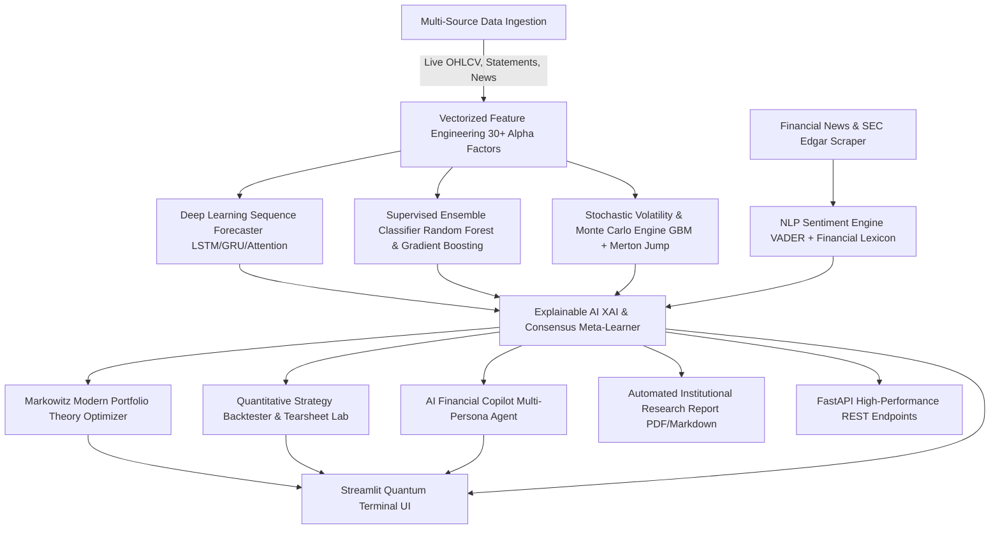

# ⚡ AI-Based Financial Analysis & Investment Intelligence System
### **Computer Science & Artificial Intelligence / Machine Learning (CSAIML) Capstone System**

[](https://www.python.org/)
[](https://fastapi.tiangolo.com/)
[](https://streamlit.io/)
[](https://opensource.org/licenses/MIT)

---

## 🌟 Executive Overview
The **AI-Based Financial Analysis & Investment Intelligence System** is an end-to-end quantitative trading, predictive analytics, and risk management terminal engineered specifically for CSAIML.

The platform bridges **Deep Learning sequence modeling**, **Supervised Gradient Boosting**, **Financial Natural Language Processing (NLP)**, **Modern Portfolio Theory (MPT)**, **Stochastic Monte Carlo Jump-Diffusion Simulation**, and **Explainable AI (XAI)** to deliver institutional-grade investment verdicts.

---

## 🏛️ System Architecture



---

## 🔬 Mathematical & Algorithmic Foundations

### 1. Stochastic Price Path: Merton Jump Diffusion Model
$$S(t) = S(0) \exp\left(\left(\mu - \frac{1}{2}\sigma^2 - \lambda k\right)t + \sigma W(t) + \sum_{i=1}^{N(t)} Y_i\right)$$
Where:
- $\mu$: Asset drift rate
- $\sigma$: Instantaneous continuous diffusion volatility
- $W(t)$: Standard Wiener process
- $N(t) \sim \text{Poisson}(\lambda t)$: Jump arrival process
- $Y_i \sim \mathcal{N}(\mu_J, \sigma_J^2)$: Log-normal jump magnitude

### 2. Value-at-Risk (VaR) & Expected Shortfall (CVaR)
- **Parametric VaR:**
  $$\text{VaR}_\alpha = -(\mu - z_\alpha \sigma)$$
- **Conditional Value-at-Risk (Expected Shortfall):**
  $$\text{CVaR}_\alpha = -\mathbb{E}[R \mid R \le -\text{VaR}_\alpha] = -\frac{1}{1-\alpha}\int_{-\infty}^{-\text{VaR}_\alpha} r f(r)\, dr$$

### 3. Markowitz Mean-Variance Efficient Frontier
$$\min_{\mathbf{w}} \frac{1}{2} \mathbf{w}^T \mathbf{\Sigma} \mathbf{w} \quad \text{subject to} \quad \mathbf{w}^T \boldsymbol{\mu} = \mu_0, \quad \sum_{i=1}^N w_i = 1, \quad w_i \ge 0$$
$$\text{Max Sharpe Tangency Portfolio:} \quad \max_{\mathbf{w}} \frac{\mathbf{w}^T \boldsymbol{\mu} - R_f}{\sqrt{\mathbf{w}^T \mathbf{\Sigma} \mathbf{w}}}$$

### 4. Risk-Adjusted Ratios
$$\text{Sharpe Ratio} = \frac{\mathbb{E}[R_p - R_f]}{\sigma_p}, \quad \text{Sortino Ratio} = \frac{\mathbb{E}[R_p - R_f]}{\sigma_{\text{downside}}}, \quad \text{Calmar Ratio} = \frac{\text{CAGR}}{|\text{Max Drawdown}|}$$

---

## 🚀 Quickstart & Execution Guide

### 1. Installation
Clone the repository and install dependencies:
```bash
pip install -r requirements.txt
```

### 2. Launch Interactive Financial Terminal Dashboard
```bash
python run_system.py --dashboard
# or directly:
streamlit run app.py
```
Open your browser at `http://localhost:8501`.

### 3. Launch FastAPI REST Backend
```bash
python run_system.py --api
# or directly:
uvicorn api:app --reload --port 8000
```
Interactive Swagger API docs available at `http://localhost:8000/docs`.

### 4. Run Automated Test Suite
```bash
python run_system.py --test
# or directly:
pytest tests/ -v
```

---

## 🎛️ Terminal Features & Navigation

| Module Tab | Key Features |
| :--- | :--- |
| 📈 **Market Intelligence** | Live Candlesticks, Multi-Moving Averages (20/50/200), Bollinger Bands, MACD, RSI, Balance Sheet, Income Statement & Cash Flow viewer. |
| 🧠 **AI Forecasting & XAI** | Deep Learning sequence price path, 80% & 95% confidence intervals, Adam loss convergence, test set validation, and Explainable AI (XAI) feature importance attribution. |
| 📰 **NLP News Radar** | Real-time financial headline scraper, sentiment polarity gauges, positive/neutral/negative breakdown, and theme cluster extraction. |
| 🎲 **Monte Carlo & Risk** | 1,000-path stochastic Jump-Diffusion projections, VaR (95%/99%), CVaR, historical crisis stress testing (2008 GFC, 2020 COVID, 2022 Tech crash). |
| 💼 **Portfolio Optimizer** | Markowitz Efficient Frontier scatter plot, Max Sharpe tangency allocation, Min Volatility portfolio, and multi-asset correlation matrix. |
| 📊 **Strategy Backtester** | AI Consensus vs Dual EMA Crossover vs RSI Mean Reversion vs Buy & Hold Benchmark with CAGR, Sharpe, Drawdowns, Trade Logs, and Monthly Returns. |
| 🤖 **AI Copilot & Reports** | Multi-Persona financial analyst chat (Wall Street Analyst, Warren Buffett, Quant Risk Officer, Tech Specialist) and 1-Click Institutional PDF Research Report Generator. |
| 💰 **Paper Trading** | Simulated live trading wallet with cash balance management, position tracker, market orders, and real-time realized/unrealized P&L. |

---

## 📂 Project Structure

```
AI_Based_Financial_Analysis_Investment_Intelligence_System/
├── app.py                      # Main Streamlit Financial Terminal Entrypoint
├── api.py                      # FastAPI REST API Backend
├── run_system.py               # One-click CLI Launcher for UI, API, and Tests
├── requirements.txt            # Python Dependencies
├── README.md                   # Complete Documentation & CSAIML Capstone Manual
├── src/
│   ├── __init__.py
│   ├── config.py               # Global Configuration, Asset Universes, Risk Defaults
│   ├── data/
│   │   ├── __init__.py
│   │   ├── market_loader.py    # Multi-Asset Data Pipeline & Real-Time Ingestion
│   │   ├── fundamental_loader.py # Financial Statements & Piotroski Health Scores
│   │   └── news_fetcher.py     # Real-Time Financial News & RSS Scraper
│   ├── models/
│   │   ├── __init__.py
│   │   ├── feature_engineering.py # 30+ Quantitative Technical Indicators
│   │   ├── deep_learning_model.py # Sequence Neural Network with Attention
│   │   ├── ml_classifiers.py   # Random Forest & Gradient Boosting Signal Models
│   │   └── ensemble_engine.py  # Meta-Learner Consensus Verdict Synthesizer
│   ├── risk/
│   │   ├── __init__.py
│   │   ├── monte_carlo.py      # Merton Jump Diffusion & Stochastic Simulations
│   │   └── risk_metrics.py     # VaR (95%/99%), CVaR, Drawdowns & Stress Testing
│   ├── nlp/
│   │   ├── __init__.py
│   │   ├── sentiment_engine.py # VADER + Financial Lexicon Sentiment Analyzer
│   │   └── copilot_agent.py    # Conversational Multi-Persona AI Analyst
│   ├── portfolio/
│   │   ├── __init__.py
│   │   ├── optimizer.py        # Markowitz Efficient Frontier & MPT Optimizer
│   │   ├── backtester.py       # Algorithmic Strategy Backtesting & Tearsheet Lab
│   │   └── paper_trader.py     # Virtual Portfolio Simulator & Order Book
│   ├── xai/
│   │   ├── __init__.py
│   │   └── explainability.py   # Explainable AI & Feature Attribution Engine
│   ├── reports/
│   │   ├── __init__.py
│   │   └── pdf_generator.py    # Downloadable Institutional PDF / Markdown Reports
│   └── ui/
│       ├── __init__.py
│       ├── components.py       # Custom Cyberpunk Dark CSS, Cards & Themes
│       └── views/              # 8 Modular Tab Views
└── tests/
    ├── test_data_loader.py     # Data pipeline unit tests
    ├── test_ml_models.py       # Feature engineering & ML tests
    ├── test_risk_metrics.py    # Risk & Monte Carlo tests
    ├── test_portfolio.py       # Portfolio optimizer & backtest tests
    └── test_sentiment.py       # NLP sentiment & Copilot tests
```

---

## 🛡️ License
Distributed under the **MIT License**. Engineered for academic research, algorithmic finance exploration, and computer science capstone evaluation.
